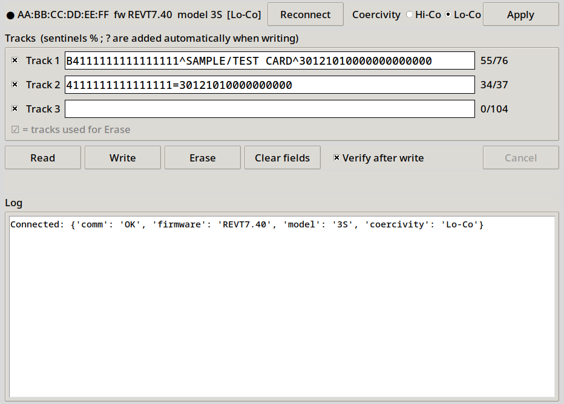

# msrx6-util

Dependency-free Linux tools for the Deftun MSRX6 magstripe reader/writer
(MSR605X-compatible `ESC` command protocol).

Works over **USB** (raw HID, `/dev/hidrawN`) or **Bluetooth** (SPP / RFCOMM channel 1).
USB is tried first, then the first paired Bluetooth device named `MSRX6*`.



## Usage

```sh
./msrx6.py info                      # firmware / model / coercivity
./msrx6.py read                      # swipe a card, print tracks 1-3
./msrx6.py write -1 ABC -2 123 -3 4  # arm write, then swipe
./msrx6.py erase [-t 1,2,3]          # arm erase, then swipe
./msrx6.py hico | loco               # set write coercivity
./msrx6_gui.py                       # Tk GUI

./msrx6.py --dev bt info             # force Bluetooth (auto-find paired MSRX6*)
./msrx6.py --dev AA:BB:CC:DD:EE:FF info
./msrx6.py --dev /dev/hidraw3 info   # force a specific USB node
```

`MSR_DEBUG=1 ./msrx6.py read` prints the raw response bytes.

## Setup

**USB:** install the udev rule so your user can open the hidraw node without sudo:

```sh
sudo cp udev/70-msrx6.rules /etc/udev/rules.d/
sudo udevadm control --reload && sudo udevadm trigger
```

**Bluetooth:** pair once with `bluetoothctl` (`scan on`, `pair <MAC>`, `trust <MAC>`).
No `rfcomm bind` needed; the tool opens the RFCOMM socket directly.
The CSR8510 dongle shipped with the reader is optional if the PC has built-in Bluetooth.

## Protocol notes

- USB: 64-byte HID reports, header byte = `0x80` first | `0x40` last | payload length (<=63).
- Bluetooth: the same commands as raw, unframed bytes. A response is treated as complete
  after 0.3 s of silence.
- Tested: firmware `REVT7.40`, model `3S` (3-track).

`tools/bt_probe.py <MAC>` is a minimal RFCOMM connectivity check (`ESC e` / `ESC v` / `ESC t`).

## License

Copyright (C) 2026 Nix

This program is free software: you can redistribute it and/or modify it under the terms of
the GNU General Public License as published by the Free Software Foundation, either version 3
of the License, or (at your option) any later version. See [LICENSE](LICENSE).
